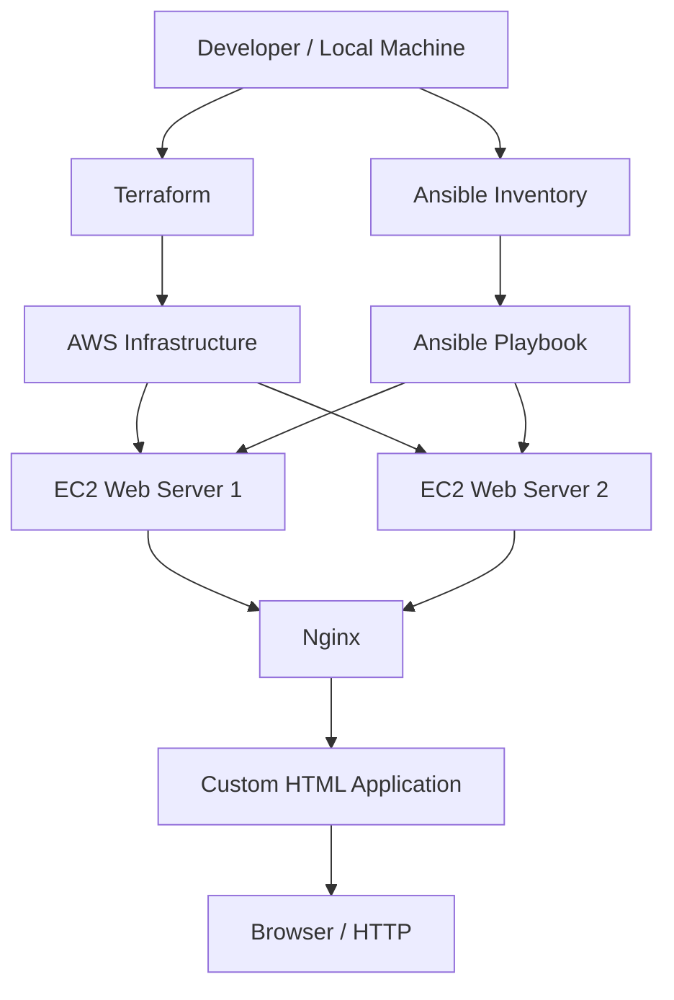

# terraform-ansible-aws-automation
aws-infrastructure-automation
# AWS Infrastructure Automation with Terraform & Ansible


## Project Overview

This project demonstrates automated AWS infrastructure provisioning and configuration management using **Terraform and Ansible**.

The objective is to provision multiple AWS EC2 instances using Infrastructure as Code (IaC), configure them consistently through Ansible, install and manage Nginx, and deploy a custom web application across multiple servers.

The implementation eliminates repetitive manual server configuration and demonstrates a repeatable approach to infrastructure deployment.

## Architecture



## Technology Stack

| Technology | Purpose |
|---|---|
| AWS EC2 | Cloud compute infrastructure |
| Terraform | Infrastructure provisioning |
| Ansible | Configuration management |
| Ubuntu 22.04 | Server operating system |
| Nginx | Web server |
| YAML | Ansible playbook configuration |
| HTML/CSS | Custom web application |
| SSH | Secure remote server access |
| Git & GitHub | Version control |

## Project Structure

```text
aws-terraform-ansible-configuration-management/
│
├── ansible/
│   ├── files/
│   │   └── index.html
│   │
│   ├── playbooks/
│   │   └── setup.yml
│   │
│   ├── inventory.ini.example
│   └── .gitignore
│
├── terraform/
│   ├── main.tf
│   ├── variables.tf
│   ├── output.tf
│   └── .terraform.lock.hcl
│
├── .gitignore
└── README.md
```

## Implementation

### 1. Infrastructure Provisioning with Terraform

Terraform is used to define and provision the AWS infrastructure.

Key activities:
- Define AWS infrastructure using declarative configuration.
- Provision two EC2 web server instances.
- Configure infrastructure parameters through variables.
- Generate infrastructure outputs for server connectivity.
- Maintain provider version consistency through the dependency lock file.

### 2. Configuration Management with Ansible

Ansible automates the configuration of both EC2 instances through SSH.

The inventory defines the target web servers, while the playbook applies configuration consistently across them.

### 3. Nginx Installation and Configuration

The Ansible playbook performs the following tasks:

- Updates the APT package cache.
- Installs Nginx.
- Ensures the Nginx service is running.
- Enables Nginx to start automatically after reboot.

### 4. Application Deployment

A custom HTML application is deployed using Ansible's copy module.

The application is copied to:

```text
/var/www/html/index.html
```

The file ownership and permissions are configured for the Nginx web server.

### 5. Verification

Successful execution is verified through:

- Ansible playbook execution.
- Successful task completion on both EC2 instances.
- Nginx service status.
- HTTP access to both servers through their public IP addresses.
- Consistent application deployment across both instances.

## Prerequisites

Before running the project, install:

- Terraform
- Ansible
- AWS CLI
- Git
- An AWS account with appropriate permissions
- An SSH key pair for EC2 access

Configure AWS credentials using an AWS CLI profile or environment variables. Never commit credentials or private keys.

## Deployment Guide

### Step 1: Clone the repository

```bash
git clone https://github.com/YOUR_USERNAME/aws-terraform-ansible-configuration-management.git

cd aws-terraform-ansible-configuration-management
```

### Step 2: Configure AWS credentials

```bash
aws configure
```

Verify access:

```bash
aws sts get-caller-identity
```

### Step 3: Provision infrastructure

```bash
cd terraform

terraform init

terraform validate

terraform plan

terraform apply
```

Review the proposed changes before confirming the deployment.

### Step 4: Configure Ansible inventory

Return to the project root:

```bash
cd ..
```

Create your local inventory:

```bash
cp ansible/inventory.ini.example ansible/inventory.ini
```

Update the inventory with the actual EC2 public IP addresses and SSH private key location.

### Step 5: Verify SSH connectivity

```bash
cd ansible

ansible all -i inventory.ini -m ping --private-key ~/.ssh/YOUR_KEY.pem
```

Expected result:

```text
web1 | SUCCESS => {
    "ping": "pong"
}

web2 | SUCCESS => {
    "ping": "pong"
}
```

### Step 6: Execute the Ansible playbook

```bash
ansible-playbook -i inventory.ini playbooks/setup.yml --private-key ~/.ssh/YOUR_KEY.pem
```

### Step 7: Access the deployed application

Open the following URLs in a browser:

```text
http://EC2_PUBLIC_IP_1
http://EC2_PUBLIC_IP_2
```

Both servers should display the custom application deployed through Ansible.

Ensure the AWS security group permits HTTP traffic on port 80 and SSH access only from trusted IP addresses.

## Key Engineering Concepts Demonstrated

- Infrastructure as Code (IaC)
- Automated cloud infrastructure provisioning
- Configuration management
- SSH-based remote administration
- Multi-server orchestration
- Linux package and service management
- Automated web application deployment
- Repeatable infrastructure configuration
- Infrastructure validation and verification

## Security Considerations

- Terraform state files and variable files are excluded from version control.
- SSH private keys are never committed.
- AWS credentials are managed outside the repository.
- Real server inventory details are excluded from public GitHub.
- SSH access should be restricted to trusted IP addresses.

## Infrastructure Cleanup

To avoid unnecessary AWS charges, destroy resources when they are no longer required.

From the Terraform directory:

```bash
terraform destroy
```

Review the proposed destruction before confirming.

## Project Outcome

Successfully automated the provisioning and configuration of two AWS EC2 web servers using Terraform and Ansible.

Both servers were configured with Nginx and received the same custom web application through a single Ansible playbook.

**This project demonstrates practical experience with AWS, Infrastructure as Code, Linux administration, configuration management and DevOps automation.**

---

**Author:** Khyati Saxena


